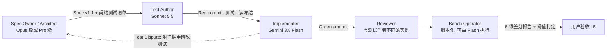
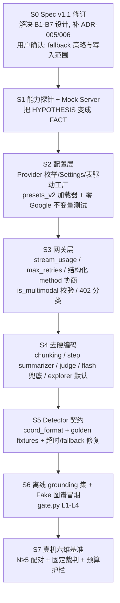

# ARTEMIS Google 解耦平替方案 — 独立架构审查报告

> **审查人**：独立架构审查 Agent（Claude Opus 5.5）
> **日期**：2026-11-08
> **审查对象**：`docs/MODEL_SELECTION.md`、`docs/ARCHITECTURE_DECISIONS.md`、`docs/TECHNICAL_SPEC_DEEPSEEK_QWEN.md`、`AGENTS.md`、`PROJECT-MAP.md`、`HANDOFF.md`
> **审查方式**：只读核对代码（未修改任何业务代码）。所有结论都按 `FACT / INFERENCE / HYPOTHESIS` 分级标注。

---

## 0. 结论摘要（先看这里）

**总体判断**：大方向是对的——保留基线、走中立抽象、冷启动切换、量化对比验收。但**技术规格书标的「Ready for Implementation」不成立**。它的扩展点只写到 `ModelFactory` 这一层，而按代码实际情况，在 `ds-qwen-hybrid` 预设下，至少有 **7 个阻断项（P0）** 会让系统**悄悄退回 Google、报 400 后不触发降级、或者让记忆压缩与成本计量失效**。这些问题直接违反 P-001（核心能力保全）和 P-002（供应商中立）。

| # | 阻断项（P0） | 证据等级 | 后果 |
|---|---|---|---|
| B1 | `presets` 机制在 Python 侧**根本没有被读取**；`active_preset` / `ARTEMIS_PRESET` / `--preset` 都是新功能，规格书没给加载器设计 | FACT | ADR-003 没有实现基础 |
| B2 | 节点配置**继承 provider 时会漏**，另外还有**硬编码的 Google 调用点**（摘要器、Chunking、轻量裁判、Flash 兜底） | FACT | 切到 DeepSeek 后仍然调 Google；没有 Google Key 时记忆压缩管线整条失效 |
| B3 | Fallback 链路**同厂商 + 模态不匹配**；400 被归为 `BAD_REQUEST`，**不触发降级** | FACT + INFERENCE | P-004 承诺的“高可靠 Fallback”实际走不通 |
| B4 | `with_structured_output` 在 `ChatOpenAI` 下默认用 `json_schema` | FACT（库源码） / HYPOTHESIS（DeepSeek 是否拒收） | Checker 与 Planner Validation 可能 400 而且不降级 |
| B5 | `ChatOpenAI` 配自定义 `base_url` 时**默认不在流式响应里返回 usage** | FACT（库源码） | Token 计量、成本维度、Transcript 压缩阈值失真 |
| B6 | Object Detector 坐标约定有矛盾：prompt 要求 `[y,x]` + 代码无条件交换，规格书里 `box_2d` / `bbox_2d` 被同等看待，Qwen2.5-VL 输出的是绝对像素 | FACT + INFERENCE | 视觉兜底点击会系统性错位 |
| B7 | Detector 单 label 超时 10s，比 RateLimit 退避的基准 10s 还短；异常被吞掉；Detector 路径不走 Fallback | FACT | 自建 27B 一慢就会持续返回空结果，Qwen fallback 永远不会被调用 |

**建议**：把规格书状态改回 **Draft**。先按本报告 §6 做一次 **Spec v1.1 修订**（预计改动集中在配置解析层和 Detector 契约），再进入 TDD 实施。

---

## 1. 审查证据基线

| 项 | 结果 | 等级 |
|---|---|---|
| `uv run pytest tests/unit/test_llm_gateway.py tests/unit/test_llm_reliability.py tests/unit/test_llm_structured.py -q` | `25 passed, 1 warning in 1.27s` | FACT |
| `node .agents/skills/workbench-project/scripts/check.mjs doctor .` | `"status": "healthy"`（注意：doctor 自己声明只做只读路径检查，不执行命令） | FACT |
| `which semble codegraph gh` | `semble`、`codegraph` **未安装**；`gh` 可用 | FACT |
| `langchain-openai` 版本 | `1.5.2`；未安装 `langchain-deepseek` | FACT |
| 运行环境 | `.venv` 是 **Python 3.14**（AGENTS L3 只写 3.12+；`google.genai` 已出现 3.14 弃用告警） | FACT |

> [!WARNING]
> AGENTS.md P-005 要求优先用 `semble` / `codegraph`，但这两个工具都不存在。后续 Agent 要么先安装，要么在契约里把它们降级为“可选”。否则自主 Agent 会在工具策略上卡住，或者被迫违规。

---

## 2. Q1：多模型组队分工评估

### 2.1 拟议分工
- **开发**：Gemini 3.8 Flash（实现 `settings.py` / `router.py` / 配置模板）
- **测试 + 审查**：Claude Sonnet 5.5（先写 TDD 测试，补边界用例，交付前做 Code Review）

### 2.2 评估结论：**结构合理，但用错了地方，还缺两个角色**

**做得对的地方**
1. **写实现的人和写测试的人分开**，能有效减少“自己写测试验证自己”的偏差，符合宪法第 4 条。
2. 改动量小、机械性强的部分（加枚举、加 Settings 字段、表驱动的 Provider 分支）交给 Flash 级模型，性价比合理。

**风险与盲区**

| 风险 | 说明 | 等级 |
|---|---|---|
| R1 **规格书本身有错时，测试会把错误固化** | Sonnet 按规格书写先验测试，而规格书在 B1/B5/B6 上和代码事实冲突（比如 `box_2d` 与 `bbox_2d` 被同等看待、presets 用了嵌套 schema）。测试会把错误当成正确断言，Flash 只要让测试变绿就完成了，两个 Agent **一致地错**。 | INFERENCE |
| R2 **真正难的不在编码量** | 本任务的难点是**横切的配置语义**：预设合并的优先级、provider 继承泄漏、硬编码 Google 调用点的盘点、结构化输出方式的协商、坐标约定。这些需要设计判断，不是机械实现，Flash 级模型在这里风险偏高。 | INFERENCE |
| R3 **测试作者同时做 Code Review** | Reviewer 对自己写的测试有路径依赖，测试本身没人审。 | INFERENCE |
| R4 **和既有决策冲突** | `HANDOFF.md` §5 写的是“单 Agent + 原子 Skill 工作流（严格按 TDD 推进，不伪造 Fabric 多角色）”，新分工与之矛盾，需要用户显式改这条决策。 | FACT |
| R5 **没有人负责 E2E 与基准跑批** | 两个角色都只覆盖单元层，没人负责真机/模拟器跑批、6 维报告和阈值判定，而 L4/L5 门禁恰好落在这里。 | FACT（分工表里没有） |
| R6 **“开发者是 Gemini”带来的隐性偏好** | 开发模型可能下意识沿用 Gemini 的约定（如 `box_2d` 是 `[ymin,xmin,ymax,xmax]`），并把它当成通用约定。 | HYPOTHESIS（低） |

### 2.3 推荐的调整版分工



**分工规则建议**
1. **Spec Owner**（Opus 或 Pro 级，可以复用本审查会话）负责解决本报告列出的 P0 设计问题，产出 `Spec v1.1` 和“契约测试清单”。测试作者**必须以代码事实和供应商文档为依据**，而不是只看规格书。
2. **Implementer 不得修改测试文件**（宪法第 6 条）。认为测试有误时，走 **Test Dispute**：附上证据提交给 Spec Owner 仲裁，不能私自改断言。
3. **Reviewer 与测试作者分开**：至少换一个 Sonnet 新会话，用 `matt-code-review` 的 Standards + Spec 双轴审查，同时审测试本身。
4. **新增 Bench Operator 角色**：只执行脚本、产出报告，不改代码；阈值判定由脚本机器完成，不靠 Agent 自己报告。
5. 工作区隔离：每个角色用 `branch` / `share` 工作区，通过 Git commit 交接（Red → Green → Review）。不要共用一个工作区同时写。
6. 把以上决策写进 `HANDOFF.md` §5，替换“单 Agent”这条结论（需要用户确认）。

---

## 3. Q2：方案审查与盲点补充

### 3.1 配置与预设层（ADR-003 的实现基础）

#### B1 预设机制不存在，schema 冲突 — **P0**
- **FACT**：`grep presets|active_preset|ARTEMIS_PRESET`（范围：`artemis/`、`third_party/` 下的 `.py`）**没有任何命中**（只有 `agent.py` 里不相关的 verification presets）。
- **FACT**：`parse_llm_config()` → `_expand_default_into_nodes()` 只读 `default` 和 `nodes` 两个键（[llm.py#L133-L197](file:///Users/zw-mini/orca/artemis/artemis/config/llm.py#L133-L197)）。
- **FACT**：现有 `presets` 是**扁平 schema** `{provider, model, fallback}`（[artemis.jsonc#L23-L49](file:///Users/zw-mini/orca/artemis/config/artemis.jsonc#L23-L49)），而规格书提议的是**嵌套 schema** `{default, nodes}`。
- **FACT**：Admin Console 把 `presets` 原样返回给前端（[system.py#L489](file:///Users/zw-mini/orca/artemis/apps/admin_console/routers/system.py#L489)）。改 schema 可能破坏前端（前端是否消费此字段尚未核实）。
- **规格书缺少的设计**：
  1. **合并优先级**：`CLI --preset` > `ARTEMIS_PRESET` > `active_preset` > 顶层 `default`。另外，顶层 `nodes`（如 `planner.thinking_level: high`、`hopper.model`）和 preset 内的 `nodes` 谁覆盖谁？
  2. `agent.*` 下只写了 model 名的字段（`step_summarizer.model`、`memory.chunking.model`）如何受预设控制。
  3. 未知 preset 名必须 **fail-fast**，不能静默回退到 Gemini。
- **建议**：新建独立的 `presets_v2`（或 `profiles`）键承载嵌套 schema，保留旧 `presets` 不动，避免破坏 Admin Console。加载器写成纯函数 `resolve_llm_config(raw: dict, preset: str | None) -> dict`，便于单元测试。

#### B2 Provider 继承泄漏与硬编码 Google — **P0**
- **FACT**：节点配置是先复制 `default`，再逐键覆盖（[llm.py#L175-L183](file:///Users/zw-mini/orca/artemis/artemis/config/llm.py#L175-L183)）。所以**只写了 `model`、没写 `provider` 的节点会继承 default 的 provider**：
  - `hopper: {model: "gemini-3.5-flash-lite"}`（[artemis.jsonc#L97-L103](file:///Users/zw-mini/orca/artemis/config/artemis.jsonc#L97-L103)）→ 在 DeepSeek default 下会变成 `deepseek/gemini-3.5-flash-lite` → 404 → 归类为 `BAD_REQUEST` → **不降级**。
  - `fallback` 是字典合并，default 里的 `thinking_level` 会渗进所有节点的 fallback。
- **FACT**：下列调用点**完全绕过 preset**，直接调用 Google（违反 P-002）：

  | 位置 | 内容 | 影响的核心能力 |
  |---|---|---|
  | [chunking.py#L328](file:///Users/zw-mini/orca/artemis/artemis/memory/chunking.py#L328), [#L335](file:///Users/zw-mini/orca/artemis/artemis/memory/chunking.py#L335) | `get_google_llm(...)`：L2 Chunk 压缩主模型和 fallback | Transcript Ledger 分段压缩 |
  | [summarizer.py#L169-L173](file:///Users/zw-mini/orca/artemis/artemis/agents/flash/summarizer.py#L169-L173) | 配了 `model_name` 时直接用 `get_google_llm`；异常时也兜底到 Google | Flash 异步视觉步骤摘要 |
  | [runner.py#L287](file:///Users/zw-mini/orca/artemis/artemis/agents/flash/runner.py#L287) | Operator 初始化失败时兜底到 `gemini-2.5-flash` | Flash 主循环 |
  | [llm.py#L60-L72](file:///Users/zw-mini/orca/artemis/artemis/config/llm.py#L60-L72) | `lightweight_judge_default()` 写死了 Google | Planner Validation、Pixel Safety Net |
  | [explorer/constants.py#L26](file:///Users/zw-mini/orca/artemis/artemis/agents/explorer/constants.py#L26) | `DEFAULT_EXPLORER_MODEL = "gemini-3.8-flash"` | Explorer 默认模型 |
  | [services/llm.py#L926-L927](file:///Users/zw-mini/orca/artemis/artemis/services/llm.py#L926-L927) | `_resolve_endpoint` 缺字段时默认 `google` / `gemini-2.5-flash` | 全局 |

- **INFERENCE**：在 `ds-qwen-hybrid` 预设下且未配置 `GOOGLE_API_KEY` 时，步骤摘要和 Chunk 压缩会持续失败 → 截图不会被原地替换为摘要 → 上下文膨胀 → 直接损害 P-001 列出的“异步 Transcript 压缩”能力。
- **FACT**：`validate_provider` 里没有 `deepseek` / `qwen` 分支（[third_party llm.py#L67-L85](file:///Users/zw-mini/orca/artemis/third_party/mobile_use/config/llm.py#L67-L85)），缺 Key 时要到第一次调用才报错，不会在启动时就失败。
- **FACT**：`LLMProvider` Literal（[constants.py#L121-L123](file:///Users/zw-mini/orca/artemis/artemis/config/constants.py#L121-L123)）和 `ModelProvider.from_string` 映射（[router.py#L64-L78](file:///Users/zw-mini/orca/artemis/artemis/llm/router.py#L64-L78)）都需要扩充，规格书只提到了枚举。
- **建议**：增加一条**零 Google 不变量测试**（全方案最有价值的一条测试）：
  > 清空 `GOOGLE_API_KEY`，设置 `ARTEMIS_PRESET=ds-qwen-hybrid`，枚举**所有** `AgentNode`、`LLMUtilsNode`、`planner_validation`、`validator_pixel_safety_net`、step summarizer、chunking model、explorer default，解析出 endpoint 后断言 `provider ∉ {google, vertexai}`，并 monkeypatch `get_google_llm` 让它一被调用就抛异常。

### 3.2 `ModelFactory` 双通道接入

#### B3 Fallback 链路失效 — **P0**
- **FACT**：`BAD_REQUEST`（400/404/413/415/422）的 `should_fallback=False`（[reliability.py#L105-L108](file:///Users/zw-mini/orca/artemis/artemis/llm/reliability.py#L105-L108)），由 [`_ObservedFallback.fallback_reason`](file:///Users/zw-mini/orca/artemis/artemis/services/llm.py#L984-L991) 执行。
- **INFERENCE**：规格书把 `deepseek-chat` 配成主模型的 fallback。如果它是纯文本端点（历史上 `deepseek-chat` 是 V3 文本模型），收到 `image_url` 会返回 400，而 400 不触发降级，**这条 fallback 链在所有带图节点上都走不通**。
- **INFERENCE**：主备同厂商、同 Key，故障是相关的：余额不足（DeepSeek 返回 `402`，现有分类器没映射，会落到 `UNKNOWN`）、Key 失效、区域性故障时会一起挂掉。
- **FACT**：`ModelEndpoint.is_multimodal` 字段存在，但**全仓库没有任何读取方**（[router.py#L97](file:///Users/zw-mini/orca/artemis/artemis/llm/router.py#L97)），也就是说 **P-003 端点模态保护目前根本没有实现**。
- **建议**：
  1. 阶段一的 fallback 采用**跨厂商**方案（例如 `ds-qwen-hybrid.default.fallback = google/gemini-3.8-flash` 或其他多模态厂商）。“零 Google”作为阶段二目标，由用户决定。
  2. **配置加载时**校验：凡是消费图片的节点，主备都必须 `is_multimodal=true`，否则启动时直接失败。`is_multimodal` 由能力注册表或探针结果填充，不靠人手写。
  3. `classify_failure` 增加 `402`（余额不足，语义上是“换端点能修好”）和厂商特定的错误文案。

#### B4 结构化输出方式 — **P0（待验证）**
- **FACT**：`langchain_openai` 1.5.2 中 `ChatOpenAI.with_structured_output` 默认 `method="json_schema"`（`.venv/.../langchain_openai/chat_models/base.py:3641`）。
- **FACT**：Checker（[checker.py#L411](file:///Users/zw-mini/orca/artemis/artemis/agents/checker/checker.py#L411)）和 Planner Validation（[planner.py#L188](file:///Users/zw-mini/orca/artemis/artemis/agents/planner/planner.py#L188)）都直接调用 `with_structured_output(Schema)`。
- **HYPOTHESIS**：DeepSeek / Qwen 的兼容接口可能不支持 `response_format: {type: json_schema, strict}`（DeepSeek 历史上只支持 `json_object` 和 function calling）。如果是这样，就会 400 → 不降级 → **Checker 最终验收直接失败**。
  - **验证手段**：用能力探针（§4.1）对真实端点各发一次 `json_schema`、`json_mode`、`function_calling`。
  - **回退路线**：在 `RobustChatModelWrapper.with_structured_output` 里按 endpoint 能力注入 `method=`（优先 `function_calling`），业务节点代码不动。

#### B5 流式 usage 与 SDK 内部重试 — **P0**
- **FACT**：只有在 `base_url` 为空（官方 OpenAI）时，`ChatOpenAI` 才会自动设置 `stream_usage=True`（`base.py:1278-1282`）。`RobustChatModelWrapper.complete()` 默认走 `astream`（[services/llm.py#L691-L745](file:///Users/zw-mini/orca/artemis/artemis/services/llm.py#L691-L745)）。
- **INFERENCE**：DeepSeek / Qwen 的流式响应没有 `usage_metadata` → `record_llm_usage` 返回 `None` →（1）成本维度读到 0；（2）Transcript 的 `start_ratio` / `soft_ratio` 依赖“Operator 实测的 prompt 大小”（[artemis.jsonc#L211-L217](file:///Users/zw-mini/orca/artemis/config/artemis.jsonc#L211-L217)），**压缩节奏会失真**。
- **FACT**：`max_retries=None` 时 langchain 不把这个参数传给 openai client（`base.py:1302-1303`）。**INFERENCE**：openai SDK 默认会重试 2 次，叠加 Artemis 自己的 `_run_with_recovery`，重试次数相乘、延迟膨胀；而重试遥测只采集 Google SDK 的日志（[services/llm.py#L261](file:///Users/zw-mini/orca/artemis/artemis/services/llm.py#L261)），**可靠性维度会少报**。
- **建议**：在所有 OpenAI 兼容分支里统一注入 `stream_usage=True`、`max_retries=0`（由 Artemis 统一负责重试），并透传 `max_tokens`。

#### 其他 ModelFactory 建议（P1）
1. **去重复**：规格书里 DeepSeek 和 Qwen 的分支几乎是逐行复制，现有的 OpenRouter / XAI 也一样。建议改成表驱动：
   ```python
   _OPENAI_COMPATIBLE = {
       ModelProvider.DEEPSEEK: ("DEEPSEEK_API_KEY", "DEEPSEEK_BASE_URL"),
       ModelProvider.QWEN:     ("QWEN_API_KEY", "QWEN_BASE_URL"),
       # OPENROUTER / XAI 可后续迁入
   }
   ```
   这样新增厂商只需要加一行配置和一条测试，能保持 `ModelFactory` 这个模块“深而窄”（matt-codebase-design 的说法）。
2. **思考链（thinking）丢失**：**FACT**：`ChatOpenAI` 文件头明确说明不提取 `reasoning_content`，建议改用 `ChatDeepSeek`（`base.py:1-11`）。**INFERENCE**：Operator 和 Checker 的 `include_thoughts: true` 在 DeepSeek 下会失效（UI 不再显示思考过程）。`thinking_level: high`（Planner）会被静默忽略，基准对比因此不公平。**HYPOTHESIS**：DeepSeek 在思考模式下做多轮工具调用时，对是否回传 `reasoning_content` 有特殊要求，需要查官方文档并做一次真实调用确认。按 AGENTS §3.1 的 `gh` 策略，应先比较 `langchain-deepseek`、`langchain-qwq` / `ChatTongyi` 与“直接用 ChatOpenAI”的取舍。
3. **思考档位映射**：把 `thinking_level` 和 `reasoning_effort` 映射到各厂商自己的开关（如 DeepSeek 的 thinking 开关 / `extra_body`）。不支持的档位要在启动日志里**显式警告**，不能静默丢弃。
4. **Search Grounding 被静默丢弃**：`log_analyzer` / `diagnoser_expert` 配置了 `enable_grounding: true`，在非 Google 端点下会被 Wrapper 直接过滤（[services/llm.py#L579-L584](file:///Users/zw-mini/orca/artemis/artemis/services/llm.py#L579-L584)）。诊断质量可能下降，基准报告里应单独标注这一项。
5. **测试隔离**：`ModelFactory._cache` 是类级别的全局缓存，`settings` 是 import 时加载的单例。测试必须用 fixture 清缓存并 monkeypatch `settings`，防止开发机 `.env` 里的真实 Key 泄漏进测试。

### 3.3 `ObjectDetector` 坐标自适应

#### B6 坐标约定矛盾 — **P0**
- **FACT**：Prompt 要求输出 `'point' array [y, x] (normalized to 0-1000)`（`object_detector.json`）；代码**无条件**把 `point` 从 `[y,x]` 交换成 `[x,y]`（[object_detector.py#L168-L177](file:///Users/zw-mini/orca/artemis/artemis/agents/object_detector/object_detector.py#L168-L177)）。
- **问题 1**：规格书的 `normalize_detected_coordinate` Case 1 把 `point` 原样当作 `[x,y]` 返回，和现有的交换逻辑叠加后，结果取决于插入位置，可能**交换两次或一次都不交换**。
- **问题 2（FACT，规格书代码本身）**：Case 2 把 `box_2d` 和 `bbox_2d` 同等处理，都按 `xyxy` 计算中心点。但 `box_2d` 是 **Gemini 约定的 `[ymin,xmin,ymax,xmax]`**，`bbox_2d` 才是 **Qwen 约定的 `[x1,y1,x2,y2]`**，所以 Gemini 的框会算出 x、y 颠倒的中心。规格书注释里自己写了“或”，但代码没有区分。
- **问题 3（INFERENCE，基于公开模型资料）**：Qwen2-VL / Qwen3-VL 用 0–1000 相对坐标，**Qwen2.5-VL 改为输出基于缩放后输入图（smart_resize，28 的倍数）的绝对像素坐标**。规格书把 `qwen2.5-vl-27b` 设为 fallback，同时又断言“Qwen 视觉系列原生 0~1000”，这是过度泛化。
- **问题 4（HYPOTHESIS）**：公开的 Qwen2.5-VL 规格是 3B/7B/32B/72B，“27B” 这个 SKU 需要核实。`PRITHIVSAKTHIUR/Qwen3.8-27B-Object-Detection` 看起来是社区 Demo 仓库，**不是 DashScope 的模型 ID**，但规格书默认的 `QWEN_BASE_URL` 是 DashScope，模型名和端点对不上。需要明确：是自建 vLLM（用 `--served-model-name`），还是用百炼官方模型 ID？
- **建议**：**不要靠启发式猜格式，改为由端点声明格式**。
  1. 在节点配置里加 `coord_format` 字段，可选值为 `point_yx_1000`（Gemini ER）、`point_xy_1000`、`bbox_yxyx_1000`（Gemini）、`bbox_xyxy_1000`（Qwen2/3-VL）、`bbox_xyxy_px`（Qwen2.5-VL，需附带缩放后的图像尺寸）。
  2. Prompt 模板按 `coord_format` 选择（让 Qwen 用它原生训练时的输出格式，不要强迫它输出 `[y,x]`）。
  3. 统一出口：先归一化成 `[x,y]` ∈ [0,1000]，然后裁剪到范围内，拒绝退化框（宽或高为 0、`x1 > x2`）。删除那段无条件交换逻辑，把交换移到 `point_yx_*` 格式的解析器里。
  4. 用 **Golden Fixtures** 测试：每种格式至少准备“正常 / 越界 / 退化 / 混合列表”四类样例。

#### B7 Detector 超时、重试与降级 — **P0**
- **FACT**：单 label 超时默认 10s（[object_detector.py#L45](file:///Users/zw-mini/orca/artemis/artemis/agents/object_detector/object_detector.py#L45)），并且外层 `asyncio.wait_for` 包住的是 `RobustChatModelWrapper.ainvoke`；而 RateLimit 退避的基准延迟正好也是 10s（[reliability.py#L155](file:///Users/zw-mini/orca/artemis/artemis/llm/reliability.py#L155)）。
  - **INFERENCE**：一旦遇到 429，退避还没结束就被 `wait_for` 取消了，**重试实际上永远不会发生**。
- **FACT**：`_detect_single_label` 用 `except Exception` 吞掉所有异常（[#L99-L100](file:///Users/zw-mini/orca/artemis/artemis/agents/object_detector/object_detector.py#L99-L100)）；`get_llm(ctx, name="object_detector")` 也没有套 `with_fallback`（[#L127](file:///Users/zw-mini/orca/artemis/artemis/agents/object_detector/object_detector.py#L127)）。
  - **INFERENCE**：规格书在 preset 里给 `object_detector` 配的 Qwen fallback **永远不会被用到**。
- **FACT**：`getattr(ctx.llm_config, "timeout")` 读取的是 `LLMConfig` 顶层的 `timeout`，但这个字段不存在，所以超时值永远来自环境变量（[#L131-L135](file:///Users/zw-mini/orca/artemis/artemis/agents/object_detector/object_detector.py#L131-L135)）。
- **INFERENCE**：自建 27B（4090 量化版）处理一张 1080×2400 截图时，视觉 token 通常有数千个，首 token 延迟可能接近甚至超过 10s。再乘上 `N labels × 最多 3 个模板` 次请求、`Semaphore(6)` 的并发，在单卡上排队，结果就是**持续返回空检测**。
- **建议**：超时改为按端点配置，并保证 `超时 > 退避上限`，或者在 Detector 路径上用更短的退避策略；吞异常前先记录 `llm_gave_up` 事件；在 Detector 路径上接入 `with_fallback`；同一张图只编码一次 Base64（现在每个 label 都重新编码一次，[#L47](file:///Users/zw-mini/orca/artemis/artemis/agents/object_detector/object_detector.py#L47)）。可以考虑把多个 label 合成一次请求（Qwen 支持一次 grounding 多个目标），降低调用次数。

### 3.4 用户点名的四类隐患

| 隐患 | 审查结论 | 建议 |
|---|---|---|
| **多模态 Base64 传输性能** | **FACT**：截图用 JPEG q75 原分辨率编码（[prompts.py#L898](file:///Users/zw-mini/orca/artemis/artemis/agents/operator/prompts.py#L898) 等）；历史中最多保留 6 张截图（`image_scrub_depth_relaxed: 6`）。**INFERENCE**：单次请求体可达数 MB，跨境或公网场景下上传耗时会主导“交互时延”维度。Gemini 与 DeepSeek 的图像 token 计费方式不同，`context_budget_tokens: 80000` 是按 Gemini 标定的，换模型后压缩节奏会漂移，成为**基准里的混杂变量**。 | ① 长边缩放到可配置上限（如 1280；Operator 用元素索引、Detector 用归一化坐标，缩放都安全）；② 遥测里记录 `request_bytes`；③ 历史截图的 Base64 保持字节级稳定，提高 DeepSeek 前缀缓存命中率；④ 上下文预算按模型配置（建立 context window 注册表）。 |
| **RateLimit 降级** | 见 B3、B5、B7。另外注意：同厂商 fallback 共享配额，429 时降级到同厂商没有意义。 | 跨厂商 fallback；`max_retries=0`；遵循 `Retry-After` 响应头（目前未解析）；熔断器按 `provider:model` 分 key 已经具备（FACT），保留。 |
| **无障碍树缺失时的回退时机** | **FACT**：视觉回退是**由主模型通过 `ask_explorer` 工具自主决定的**（[artemis.jsonc#L280-L281](file:///Users/zw-mini/orca/artemis/config/artemis.jsonc#L280-L281)）。**INFERENCE**：换了主模型，“何时调用 Explorer”的决策分布也会变（DeepSeek 可能更早或更晚放弃 UI 树），规格书没覆盖这一点。MODEL_SELECTION 里“90% 以上操作走无障碍树”是**未经核实的说法**。 | ① 在基准中增加**派生指标**：Explorer 调用率、首次调用前的失败步数；② 从历史 trace 统计实际的 UI 树命中率，替换“90%”这个说法；③ 可选加一道确定性保护：`minimal_list` 为空，或检测到 `SurfaceView` / `FlutterView` / `UnityPlayer` 时，在 prompt 中注入提示。 |
| **测试断言脆弱性** | 风险来源：断言 LLM 文本、依赖真实 Key、全局缓存污染、`ARTEMIS_FAKE_LLM` 绕过了 Provider 分支（**FACT**：[router.py#L212-L220](file:///Users/zw-mini/orca/artemis/artemis/llm/router.py#L212-L220) 在分支判断之前就直接返回了）。 | ① **断言请求载荷，不断言模型文本**：用 `httpx.MockTransport` / `respx` 截获发往 `/chat/completions` 的 JSON，断言 `model`、`Authorization`、`base_url`、`image_url` 是否存在、`response_format.type`、`stream_options.include_usage`；② Fake 模式只用于图谱层测试，Provider 接线必须单独测；③ 每个测试自动清理 `ModelFactory._cache`。 |

### 3.5 六维基准框架（`run_benchmark_comparison.py`）

| 问题 | 等级 | 建议 |
|---|---|---|
| **缺少统计设计**：Agent 运行不确定，小样本下“TSR ≥ 98% × Baseline”基本就是噪声 | INFERENCE | 每个用例重复 N≥5 次；做**配对比较**（同一用例两边对比）；报告 Wilson / Bootstrap 置信区间；**事先固定**样本量和判定规则 |
| **成功由谁判定**：如果用候选预设自己的 Checker 判定成功，就是“自己给自己打分” | INFERENCE | 优先用确定性断言（adb 状态、UI 树、文件、DB）；需要 LLM 判定时，两边**使用同一个固定的裁判模型** |
| “**异常自动恢复率 100%**”不可证伪 | FACT（ADR-004） | 改成**故障注入用例**：Mock 端点注入 429（带 Retry-After）、5xx、超时、流中断、畸形 JSON、402，断言恢复路径和事件序列 |
| “**时序一致性 ≥95%**”以 Gemini 为真值 | INFERENCE | 和 Gemini 一致 ≠ 正确，需要人工标注真值集 |
| **视觉定位精度**依赖真机，成本高且不确定 | INFERENCE | 建一个**离线标注集**（从历史 trace 抽取截图并标注 GT bbox，命中判定 = 预测点落在 GT 框内）。不需要设备，几分钟能跑完，可以进 CI |
| **环境漂移**：两次冷启动之间 App 版本、网络、A/B 实验可能变化 | INFERENCE | AVD 快照、固定 APK 版本、ABAB 交替执行、记录运行环境指纹 |
| **成本口径**：自建 Qwen 没有 token 单价；DeepSeek 缓存命中有单独价格 | HYPOTHESIS（`normalize_usage` 是否映射 `prompt_cache_hit_tokens` 尚未核实） | 仓库内维护带版本号的价格表；自建端点按 GPU 小时摊销；结果 JSON 里记录 `git SHA + preset hash + model id + 价格表版本` |
| 规格书里没有任务集格式 | FACT | 定义 `benchmarks/tasks/*.yaml`（目标、前置状态、确定性断言、超时、标签） |

---

## 4. Q3：提高自主性、降低 Human-in-the-Loop

目标：把“需要人判断”的环节尽量变成“机器可判定的门禁”，只在**凭据、预算、不可逆变更、规格歧义**这四类情况下才请人介入。

### 4.1 能力探针 / 环境先验探测（最高优先级）
`uv run artemis doctor --providers`（或 `scripts/probe_capabilities.py`），输出 `.artemis/capabilities.json`：

| 探测项 | 方法 | 能把哪个假设变成事实 |
|---|---|---|
| 凭据与连通性 | `GET {base_url}/models`，同时确认配置的模型 ID 存在 | `deepseek-flash-v4-1017` 这个 ID 是否真实存在 |
| 多模态 | 发送一张 8×8 的 PNG，问它是什么颜色 | `is_multimodal` |
| 结构化输出 | 依次尝试 `json_schema` → `function_calling` → `json_mode` | B4 |
| 流式 usage | 带 `stream_options.include_usage` 发一次流式请求 | B5 |
| 工具调用 + 思考模式 | 最小 tool-call 往返 | §3.2-2 |
| 坐标格式 | 用一张已知 GT 的合成图（纯色背景上的红色方块）做 grounding | B6 的 `coord_format` 是否自动识别正确 |
| 设备链路 | `adb devices`、Helper APK 版本、模拟器启动状态 | L3 |

**启动时读取 capabilities**，用它自动选择 `with_structured_output` 的 method、校验模态是否匹配、填充 `is_multimodal`。这样能把 B3、B4、B6 的大部分人工判断自动化。

### 4.2 不依赖外部服务的 Mock 自测层
1. **OpenAI 兼容 Mock Server**（如 FastAPI + 脚本化场景）：支持故障注入（429 / 402 / 5xx / 慢响应 / 流中断 / 畸形 JSON / 拒收 image_url）。它同时支撑单元测试和“可靠性”维度。
2. **录制/回放（VCR）**：真实调用只做一次并录成 cassette（必须脱敏 Key），之后 CI 全部回放，便宜、确定、可离线。
3. **`ARTEMIS_FAKE_LLM` 场景化**：给 `FakeChatModel` 加脚本化剧本（第 N 次调用返回指定工具调用），用来跑 Flash / Pro 图谱的端到端冒烟测试，不需要设备和 Key。

### 4.3 统一门禁脚本（机器裁决，不靠 Agent 自报）
`scripts/gate.py --level L1..L4 --json`，每层输出 `pass/fail + 证据路径`：
- L1：doctor 状态为 healthy
- L2：Skill 文件哈希与 `PROJECT-MAP` 能力期望表一致
- L3：Python/uv/依赖就绪 + 能力探针结果
- L4：单元测试 + 零 Google 不变量 + 离线 grounding 集 + Fake 图谱冒烟 + （可选）真机基准阈值

Agent 的终止条件统一为：**`gate.py` 返回码为 0**。不为 0 时自动进入 `matt-diagnosing-bugs` 循环，并设上限（如 3 轮）；超过上限再升级给人。

### 4.4 自动诊断与差分报告
- 复用现有遥测事件（`llm_gave_up`、`llm_fallback`、`llm_parse_repair`、`llm_stream_reset`、Detector `failed`），对失败的基准用例**自动分桶归因**：模型能力 / 协议不兼容 / 网络 / 设备 / 用例本身不稳定。
- 差分报告自动渲染为 Markdown（提交进仓库）+ `archify` 一页式说明（按需），并附上“相对上次运行的回归项”。

### 4.5 预授权决策清单（减少打断）
在 `AGENTS.md` 或 `HANDOFF.md` 里明确：

| Agent 可自主决定 | 必须请人确认 |
|---|---|
| 测试的组织方式、内部函数命名、重构 Provider 分支为表驱动 | 改变 `config/artemis.jsonc` 的默认 `active_preset` |
| 新增 OpenAI 兼容 Provider 的配置项 | 修改 `presets` 旧 schema（影响 Admin Console） |
| Detector 的 `coord_format` 解析实现 | 删除或改写既有测试断言 |
| 在预算内执行真实 API 探针 | 真机基准超过 Token / 金额预算上限 |

### 4.6 预算与安全护栏
- 基准运行时设置 `--max-cost-usd`、`--max-wall-time`，超出时自动熔断，并生成部分结果报告。
- 日志中统一对 `*_API_KEY` 脱敏；测试中禁止读取真实 `.env`（fixture 强制设置 `ENV_FILE=/dev/null` 或等效做法）。

---

## 5. 文档一致性问题（建议在 Spec v1.1 中一并修正）

| 文档 | 问题 | 等级 |
|---|---|---|
| `HANDOFF.md` §1 | 候选供应商仍写 `deepseek-chat / deepseek-reasoner`，与 §2.3 的 Flash v4 1017 矛盾 | FACT |
| `HANDOFF.md` §5 允许写入范围 | 缺 `artemis/agents/object_detector/`、`artemis/memory/chunking.py`、`artemis/agents/flash/`、`artemis/services/llm.py`、`scripts/`，而 B2/B5/B6/B7 修复都需要改这些文件 | FACT |
| `PROJECT-MAP.md` §3.2 vs 技术规格书 §2.2 | Operator 的 fallback 一处写 `google/gemini-3.8-flash`，另一处写 `deepseek-chat`，需要统一（建议采用跨厂商方案） | FACT |
| `MODEL_SELECTION.md` §1 | 遗漏 `validator_pixel_safety_net`、`memory.chunking.model`、Flash 兜底 `gemini-2.5-flash`、`summarizer` 默认 `gemini-2.5-flash-lite` | FACT |
| `MODEL_SELECTION.md` §2.2 | “Qwen 原生 0~1000” 过度泛化；“27B 单卡 4090 流畅”“空间精度超越 Gemini ER”没有实测依据 | INFERENCE |
| `ARCHITECTURE_DECISIONS.md` | 状态写“已批准”，但 ADR-003 依赖的加载器不存在；建议改为 “Accepted, pending implementation”，并补 ADR-005（结构化输出 / 能力协商）和 ADR-006（Detector 坐标契约） | FACT |
| `AGENTS.md` P-008 / 全部文档 | `deepseek flash v4 1017` 的**确切 API 模型 ID 与多模态能力**目前只来自用户陈述，应由 §4.1 探针确认后改为 FACT | HYPOTHESIS |
| 规格书 §4 | 函数名 `parse_grounding_output` 在代码中不存在（现有解析逻辑内联在 `_detect_single_label` / `_run_object_detection` 中） | FACT |

---

## 6. 建议的修订后实施顺序



每一步都以 `gate.py` 返回 0 作为进入下一步的条件；S0 和 S7 是唯一需要用户介入的两个节点。

---

## 7. 需要用户决策的开放问题

1. **阶段一是否允许跨厂商 fallback 指向 Gemini？**（推荐：允许。“零 Google 运行”作为阶段二的独立验收项。）
2. **Qwen 的部署形态**：自建 vLLM（需提供 served-model-name 和 GPU 规格）还是阿里云百炼（需提供官方模型 ID）？这决定 `coord_format` 和超时的默认值。
3. **组队模式**：是否确认把 `HANDOFF.md` §5 的“单 Agent”改为 §2.3 的五角色流水线？
4. **`presets` schema**：是否同意新建 `presets_v2` / `profiles` 键，保留旧扁平 `presets` 以兼容 Admin Console？
5. **允许写入范围扩充**：是否同意把 §5 列出的目录加入本阶段的写入范围？
